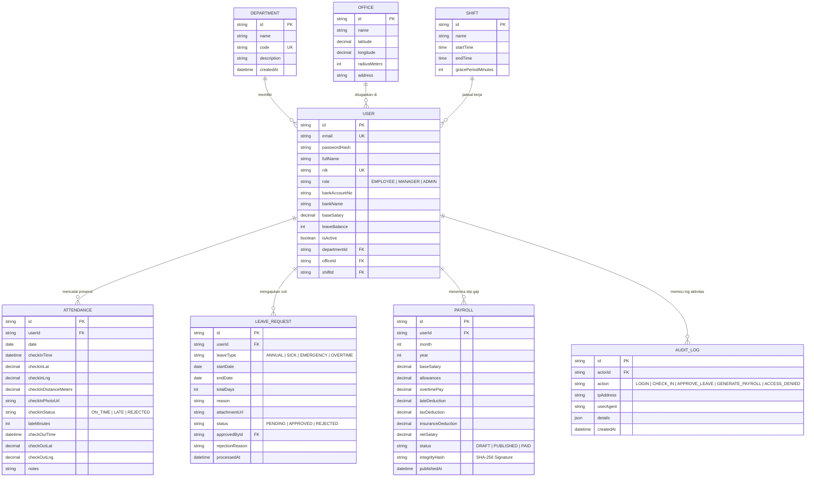

# Desain Skema Database & Relasi Entitas
## KaryaGuard — Secure HRIS, Geofenced Attendance & Payroll System

> **Database**: PostgreSQL (Neon Cloud / Local Docker)  
> **ORM**: Prisma ORM  
> **Format Waktu**: UTC (disimpan dalam `timestamptz`)

---

## 1. Diagram Relasi Entitas (ERD)



---

## 2. Spesifikasi Prisma Schema (`prisma/schema.prisma`)

```prisma
datasource db {
  provider = "postgresql"
  url      = env("DATABASE_URL")
}

generator client {
  provider = "prisma-client-js"
}

enum Role {
  EMPLOYEE
  MANAGER
  ADMIN
}

enum AttendanceStatus {
  ON_TIME
  LATE
  REJECTED
}

enum LeaveType {
  ANNUAL
  SICK
  EMERGENCY
  OVERTIME
}

enum LeaveStatus {
  PENDING
  APPROVED
  REJECTED
}

enum PayrollStatus {
  DRAFT
  PUBLISHED
  PAID
}

model Department {
  id          String   @id @default(cuid())
  name        String
  code        String   @unique
  description String?
  createdAt   DateTime @default(now())
  updatedAt   DateTime @updatedAt

  users User[]

  @@map("departments")
}

model Office {
  id           String   @id @default(cuid())
  name         String
  latitude     Decimal  @db.Decimal(10, 8) // e.g. -6.20000000
  longitude    Decimal  @db.Decimal(11, 8) // e.g. 106.81666667
  radiusMeters Int      @default(50)       // Radius toleransi geofencing dalam meter
  address      String
  createdAt    DateTime @default(now())
  updatedAt    DateTime @updatedAt

  users User[]

  @@map("offices")
}

model Shift {
  id                 String   @id @default(cuid())
  name               String   // e.g. "Reguler Pagi"
  startTime          String   // e.g. "08:00"
  endTime            String   // e.g. "17:00"
  gracePeriodMinutes Int      @default(15) // Toleransi keterlambatan dalam menit
  createdAt          DateTime @default(now())
  updatedAt          DateTime @updatedAt

  users User[]

  @@map("shifts")
}

model User {
  id            String   @id @default(cuid())
  email         String   @unique
  passwordHash  String
  fullName      String
  nik           String   @unique // Nomor Induk Karyawan
  role          Role     @default(EMPLOYEE)
  phone         String?
  bankAccountNo String?  // Field Sensitif (Data Masking)
  bankName      String?
  baseSalary    Decimal  @default(0.00) @db.Decimal(12, 2)
  leaveBalance  Int      @default(12) // Jatah cuti tahunan
  isActive      Boolean  @default(true)
  createdAt     DateTime @default(now())
  updatedAt     DateTime @updatedAt

  departmentId String?
  department   Department? @relation(fields: [departmentId], references: [id], onDelete: SetNull)

  officeId String?
  office   Office? @relation(fields: [officeId], references: [id], onDelete: SetNull)

  shiftId String?
  shift   Shift? @relation(fields: [shiftId], references: [id], onDelete: SetNull)

  attendances   Attendance[]
  leaveRequests LeaveRequest[] @relation("UserLeaveRequests")
  approvedLeaves LeaveRequest[] @relation("ApproverLeaveRequests")
  payrolls      Payroll[]
  auditLogs     AuditLog[]

  @@index([role])
  @@index([departmentId])
  @@map("users")
}

model Attendance {
  id                    String           @id @default(cuid())
  userId                String
  user                  User             @relation(fields: [userId], references: [id], onDelete: Cascade)
  date                  DateTime         @db.Date
  checkInTime           DateTime
  checkInLat            Decimal          @db.Decimal(10, 8)
  checkInLng            Decimal          @db.Decimal(11, 8)
  checkInDistanceMeters Decimal          @db.Decimal(8, 2)
  checkInPhotoUrl       String?
  checkInStatus         AttendanceStatus @default(ON_TIME)
  lateMinutes           Int              @default(0)
  checkOutTime          DateTime?
  checkOutLat           Decimal?         @db.Decimal(10, 8)
  checkOutLng           Decimal?         @db.Decimal(11, 8)
  notes                 String?
  createdAt             DateTime         @default(now())

  @@unique([userId, date]) // 1 Karyawan hanya bisa 1 attendance record per tanggal
  @@index([userId, date])
  @@index([checkInStatus])
  @@map("attendances")
}

model LeaveRequest {
  id              String      @id @default(cuid())
  userId          String
  user            User        @relation("UserLeaveRequests", fields: [userId], references: [id], onDelete: Cascade)
  leaveType       LeaveType   @default(ANNUAL)
  startDate       DateTime    @db.Date
  endDate         DateTime    @db.Date
  totalDays       Int
  reason          String
  attachmentUrl   String?     // Surat sakit / dokumen pendukung
  status          LeaveStatus @default(PENDING)
  approvedById    String?
  approver        User?       @relation("ApproverLeaveRequests", fields: [approvedById], references: [id], onDelete: SetNull)
  rejectionReason String?
  processedAt     DateTime?
  createdAt       DateTime    @default(now())
  updatedAt       DateTime    @updatedAt

  @@index([userId])
  @@index([status])
  @@map("leave_requests")
}

model Payroll {
  id                 String        @id @default(cuid())
  userId             String
  user               User          @relation(fields: [userId], references: [id], onDelete: Cascade)
  month              Int           // 1 - 12
  year               Int           // e.g. 2026
  baseSalary         Decimal       @db.Decimal(12, 2)
  allowances         Decimal       @default(0.00) @db.Decimal(12, 2)
  overtimePay        Decimal       @default(0.00) @db.Decimal(12, 2)
  lateDeduction      Decimal       @default(0.00) @db.Decimal(12, 2)
  taxDeduction       Decimal       @default(0.00) @db.Decimal(12, 2)
  insuranceDeduction Decimal       @default(0.00) @db.Decimal(12, 2)
  netSalary          Decimal       @db.Decimal(12, 2)
  status             PayrollStatus @default(DRAFT)
  integrityHash      String        // SHA-256 Signature (Mencegah Tampering Database)
  publishedAt        DateTime?
  createdAt          DateTime      @default(now())
  updatedAt          DateTime      @updatedAt

  @@unique([userId, month, year]) // 1 Slip gaji per karyawan per bulan
  @@index([userId, year, month])
  @@index([status])
  @@map("payrolls")
}

model AuditLog {
  id        String   @id @default(cuid())
  actorId   String?
  actor     User?    @relation(fields: [actorId], references: [id], onDelete: SetNull)
  action    String   // e.g. "AUTH_LOGIN", "CHECK_IN_SUCCESS", "PAYROLL_PUBLISHED", "SECURITY_ALERT"
  ipAddress String?
  userAgent String?
  details   Json?
  createdAt DateTime @default(now())

  @@index([actorId])
  @@index([action])
  @@index([createdAt])
  @@map("audit_logs")
}
```

---

## 3. Strategi Keamanan & Integritas Data

1. **Anti-Tampering Hash pada Payroll**:
   Setiap record penggajian menghasilkan hash SHA-256 dari string kanonikal:
   `SHA-256(userId + month + year + netSalary + baseSalary + SECRET_KEY)`
   Jika ada upaya manipulasi angka di database langsung, sistem akan mendeteksi ketidaksesuaian hash.
2. **Kerahasiaan Data (Data Masking)**:
   Pada level API response, field `bankAccountNo` dimasking: hanya menampilkan 4 digit terakhir (misal: `******1234`) kecuali diakses oleh HR Admin berwenang.
3. **Pemberian Indeks Strategis**:
   Setiap relasi *foreign key* dan field status pencarian (`userId, date`, `status`, `actorId`) diberikan index untuk mencegah *full table scan* dan serangan *denial of service (DoS)* saat query laporan.

